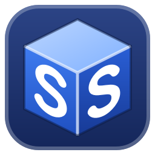

# SolidSmurfs

Wagner Machine Co.'s 3D part viewer for Windows. It looks and works like SolidWorks (menus,
CommandManager, FeatureManager tree, PropertyManager, heads-up view toolbar, Measure and Mass
Properties windows), and it opens STEP, IGES, SolidWorks parts, Parasolid and mesh files without
any CAD program installed.

## Run it

Double-click the **SolidSmurfs** shortcut on the desktop (drop files on it to open them), or
`SolidSmufs.cmd` in this folder. To put the shortcut back on a desktop:
`powershell -ExecutionPolicy Bypass -File tools\make-shortcut.ps1`. To open a file directly:

```
SolidSmufs.cmd "C:\path\to\part.step"
```

You can also drag files onto the window. Opening another file while the viewer is running adds a
tab to the window that's already open.

**Right-click menu:** right-click any part in Explorer → **Open with SolidSmurfs** (select several to
open them as tabs). Double-click still opens files in SolidWorks or whatever owns them. It's set up
for the current Windows user (no admin); to add it on another PC, or take it out:

```
powershell -ExecutionPolicy Bypass -File tools\register-context-menu.ps1
powershell -ExecutionPolicy Bypass -File tools\register-context-menu.ps1 -Remove
```

## What it opens

| Format | Extensions | How |
| --- | --- | --- |
| STEP (AP203 / AP214 / AP242, parts and assemblies, colors) | `.step` `.stp` | OpenCASCADE (through gmsh) |
| IGES | `.igs` `.iges` | OpenCASCADE; loose surfaces are stitched into solids when they close |
| OpenCASCADE BREP | `.brep` `.brp` | OpenCASCADE |
| SolidWorks part (2001 and newer) | `.sldprt` | own reader: the Parasolid body inside the file, then OpenCASCADE |
| SolidWorks assembly (2015 and newer) | `.sldasm` | own reader: the component list and placements, then each part as above (needs the part files) |
| Parasolid | `.x_t` `.x_b` `.xmt_txt` `.xmt_bin` | own reader, then OpenCASCADE |
| Meshes | `.stl` `.obj` `.ply` `.off` `.3mf` `.glb` `.gltf` | own readers; faces split at sharp creases so flat faces and holes can be picked |

CAD files are measured on the exact geometry. Meshes are measured on their triangles.

**Colors, finishes and materials:** SolidWorks parts and assemblies open in their SolidWorks colors
(read from the part, per body and per face) with a realistic finish: chrome and polished metals
reflect, satin and cast metals are duller, glossy plastics have a clear coat, rubber is matte, and
see-through parts are see-through. The finish comes from the SolidWorks appearance's name ("satin
finish stainless steel", "matte rubber"), or from the material when there's no appearance
("AISI 304" shows as satin stainless steel). The part's material and density (stored in the file)
show in the FeatureManager tree and are used by Mass Properties, Stock Size and the Quote Summary;
an assembly weighs each part with its own material. Turn **RealView Graphics** off (heads-up view
settings, or View → Display) for plain shading. STEP and IGES colors show too; those formats rarely
carry a finish or material, so they keep the plain look until you pick a material.

**SolidWorks assemblies:** an assembly file holds no geometry; it lists its part files and where
each one sits. The viewer finds each part the way SolidWorks does (where it was saved, next to the
assembly, at the same relative place, then anywhere under the assembly's folder), uses the
configuration each component calls for (a LONG and a SHORT pin show as different lengths), and opens
sub-assemblies inside it. Suppressed components are left out (not shown, measured or weighed), and
components hidden in the saved display state open hidden (show them from the tree). Parts it can't find
are listed in a message, and the rest still open; a Pack and Go zip, unzipped, has everything. Not yet:
virtual parts (stored inside the assembly), mates, exploded views, switching display states, and a
few parts whose offset surfaces the translator can't yet hand to OpenCASCADE (two in the Mouse sample).
The first open translates every part, which can take a minute for parts with many fillets; after that
it opens from the cache.

**Configurations:** a SolidWorks part opens in its first configuration, named after the part in the
FeatureManager tree (`pin (LONG)`). Right-click the part name, or open the Configurations folder and
double-click one, to show another.

**Speed:** a file you've opened before shows instantly from a cache in
`%LOCALAPPDATA%\SolidSmufs\cache` (the exact geometry for measuring loads behind it in a second or
two). Each open file runs in its own process, so a file that crashes the geometry kernel only closes
its own tab. Starting the viewer on a cached part takes about 2 seconds; with the viewer already
open, a right-clicked part shows in under half a second (a spare geometry process is kept ready, and
the page's scripts and shaders are cached in `%LOCALAPPDATA%\SolidSmufs\web`). Each launch writes
`[timing]` lines to `%APPDATA%\SolidSmufs\log.txt`.

**Save As STEP** (File menu): saves the open part or assembly as a STEP file for anyone without
SolidWorks, with its colors and part names. An assembly is saved as one STEP assembly of its placed
parts. Meshes can't be saved as STEP.

## The workspace (SolidWorks layout)

- **Title bar:** Wagner logo menu, File / Edit / View / Tools / Window / Help, quick access toolbar,
  command search (`Ctrl+F`).
- **CommandManager** tabs: **View** (open, rebuild, zoom, orientation, normal to, section view,
  display style, hide/show, appearance, scenes, perspective, save picture), **Evaluate** (Measure,
  Mass Properties, Section Properties, Bounding Box, Statistics, Draft Analysis, Zebra Stripes,
  Curvature, Edit Material) and **Tools** (Stock Size, Hole Report, Quote Summary).
- **FeatureManager design tree:** History, Annotations, Solid / Surface / Graphics Bodies, Material,
  Front / Top / Right Plane, Origin, Imported1, or the component tree for assemblies. Hide, show,
  color and select from here; the filter box finds parts in big assemblies.
- **PropertyManager** (OK / Cancel) for Section View, Appearance, Bounding Box and the analyses;
  **DisplayManager** lists every body's appearance.
- **Heads-up view toolbar**, reference triad, optional view cube, **View Selector** cube (`Space`),
  **mouse gestures** (right-drag), **shortcut bar** (`S`), a **context toolbar** beside new
  selections, **Model / 3D Views** tabs for named views.
- **Task pane:** Wagner home page and recent files, **File Explorer** for browsing folders of parts,
  Appearances & Scenes, Custom Properties.
- **Status bar:** with nothing selected, the part's best-fit size (L × W × T), box volume and part
  volume, for sizing stock at a glance; otherwise a quick measurement of the selection, Editing Part / Assembly, and the unit system
  (MMGS, CGS, MKS, IPS) like SolidWorks.

Mouse buttons default to SolidWorks (middle-drag rotate, Ctrl+middle pan, Shift+middle zoom,
left-drag box select, right-drag gestures). As in SolidWorks, the view turns about the model's
centre; middle-click a vertex, edge or face to turn about it instead (a straight edge becomes the
axis), and middle-click empty space to go back. Rolling the wheel toward you zooms in. Right-click ›
**Select Other** lists every face under the cursor, to pick one hidden behind another. On a laptop without a middle button, switch to
"Left-drag rotates" in Tools → Options → Mouse. Press `F1` for every shortcut.

## Measuring

- **Measure:** faces, edges, vertices, or any point on a face. One item gives its size; two give the
  distance, normal distance, angle and Delta X / Y / Z, drawn in the graphics area. When one of the
  two is a radius (an arc edge or a hole), a Close / Center / Far toggle for each radius picks its
  close tangent, centerline or far tangent. A radius and two or more other items give the distance
  from the radius to each of them; with two, the difference and how far off center the hole sits.
  Projected On (screen or a plane) and Measurement History as in SolidWorks.
- **Radius of a smooth bend:** click a curved face or edge that has no radius of its own in the file
  (a spline or swept surface, a fillet, a spline or elliptical edge) and it shows its radius, from the
  exact curvature: one Radius when it's constant, otherwise the radius where you clicked and the
  smallest and largest.
- **Threads:** click a tapped hole or a threaded shaft and the Measure box and status bar show its
  size (1/4-20 UNC, M6x1, 1/4-18 NPT), pitch, tap drill and thread length. Modelled threads are read
  off the helix, so the answer is definite; a plain hole (a cylinder at the tap drill or minor
  diameter, as Hole Wizard and cosmetic threads leave it) gets its most likely use and the other
  sizes it could be, unless the SolidWorks part's Hole Wizard says it has tapped holes of a size it fits, which then names it outright. Covers UNC / UNF #0 to 1", ISO metric coarse and common fine, and NPT.
- **Mass Properties:** pick a material (or a density); the report is in SolidWorks' format: mass,
  volume, surface area, center of mass, principal axes and moments, inertia at the center of mass
  and at the origin.
- **Section Properties** of flat faces, **Statistics**.
- **Bounding Box:** best fit (the smallest box, for stock), aligned to the Front / Top / Right planes,
  or aligned to selected faces: pick a flat or round face (or a straight edge) and the box stands on
  it, with length and width fitted as tight as they go; Ctrl+click a second face to set the length
  direction too. Sizes are exact, from the true surfaces.
- **Align Part:** pick a flat or round face (or a straight edge); a triad on it (its facing, the length across it, and the third) has X / Y / Z and Flip buttons on every arrow: set any two and the third follows (a second pick aims the length arrow). The other method chooses which view each pick faces (Top,
  Front, Right, ...); Ctrl+click a second pick to set the turn about it, or let the part's length run
  left to right. The geometry itself turns, exactly, so views, X / Y / Z, the bounding box, Stock Size,
  mass properties and Save As STEP all follow. The orientation is remembered for that file (it reopens turned, with a notice); Reset puts it back as modelled.
- **Stock Size:** smallest block (or one standing on picked faces, as in Bounding Box), and round bar for round parts, with allowance and rounding,
  plus stock weight. **Hole Report:** every hole by diameter, count and depth, with modelled
  thread sizes, and the rest matched to tap drills, minor diameters, clearance holes and drills. **Quote Summary:** all of it in one copyable list.

## SpaceMouse

A 3Dconnexion SpaceMouse works without any extra software beyond its usual driver: the app reads the
device directly (Windows HID). The part follows the cap: slide to pan, pull toward you to zoom in, tilt,
twist and roll to turn it about its centre (the entity you middle-clicked, or when zoomed in past the centre, the part at the middle of the view; a dot shows where). System Options has a
part / camera switch and a reverse for each axis. Set `SOLIDSMURFS_SPACEMOUSE=off` to leave it to
3DxWare.

## How it's built

- `solidsmufs/app.py`: the Qt window (PySide6 WebEngine), file dialogs, dropped files, single instance.
- `solidsmufs/server.py`: local HTTP API on 127.0.0.1 with a per-session token.
- `solidsmufs/documents.py`: one worker process per open file.
- `solidsmufs/kernel/`: loading (`cad.py` via gmsh/OpenCASCADE, `meshio.py`), the cache and tools
  (`worker.py`), measuring (`measure.py`), thread sizes (`threads.py`), mass properties and
  bounding boxes (`massprops.py`).
- `solidsmufs/formats/parasolid/`: SolidWorks / Parasolid reader (Parasolid → STEP).
- `solidsmufs/formats/sldasm.py`: SolidWorks assembly reader (components, configurations, placements).
- `solidsmufs/formats/parasolid/appearance.py`: colors, material, density and appearances in a part;
  `solidsmufs/kernel/looks.py`: the finish each body gets from them.
- `tests/`: `smoke.py` opens every sample file; `test_measure.py` checks measuring, mass properties
  and bounding boxes on a block with known answers; `test_sldasm.py` the assembly reader;
  `test_looks.py` colours, materials and configurations; `test_threads.py` thread recognition on
  modelled M6 and 1/4-20 threads (`.venv\Scripts\python -m unittest discover -s tests`).
- `solidsmufs/web/`: the interface (three.js graphics, SolidWorks-style shell, Wagner theme).

Settings and recent files live in `%APPDATA%\SolidSmufs`.

### Setting up on another PC

```
py -3.15 -m venv .venv
.venv\Scripts\python -m pip install -r requirements.txt
```
